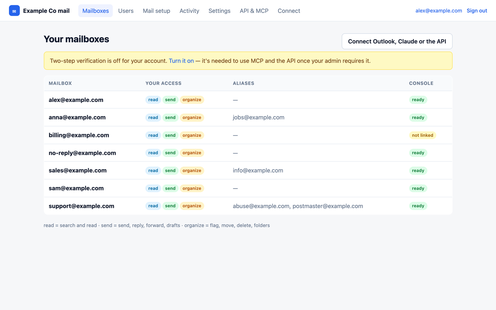
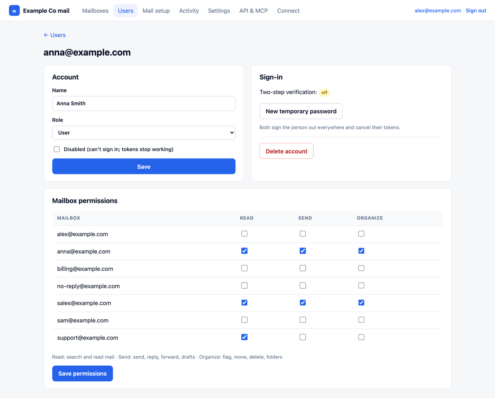
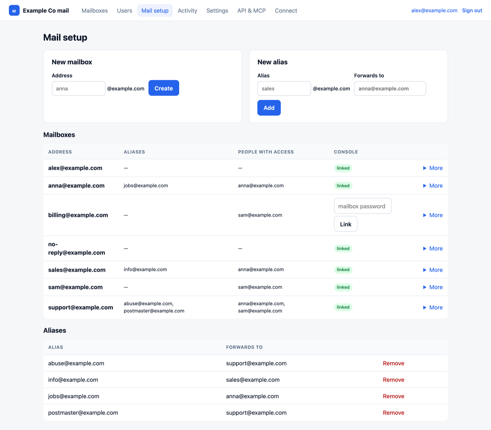
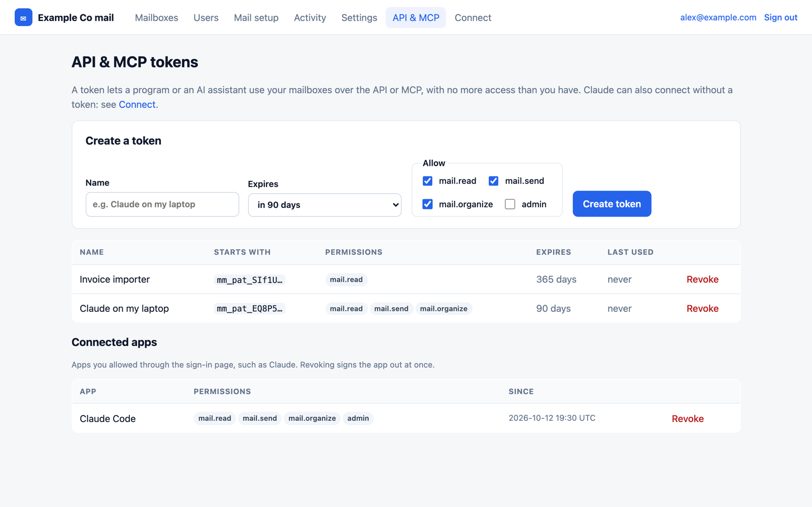
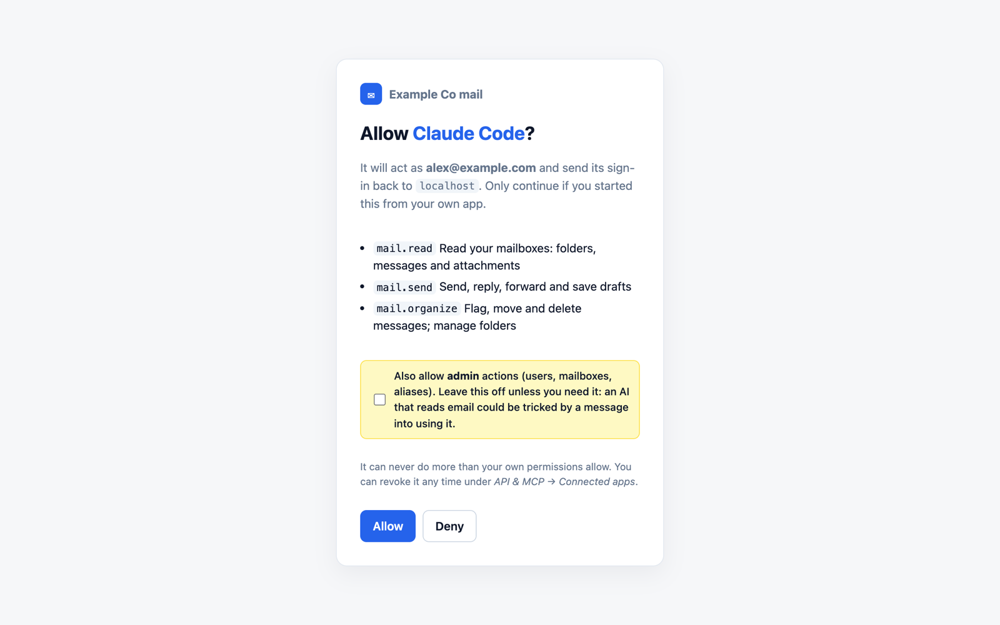
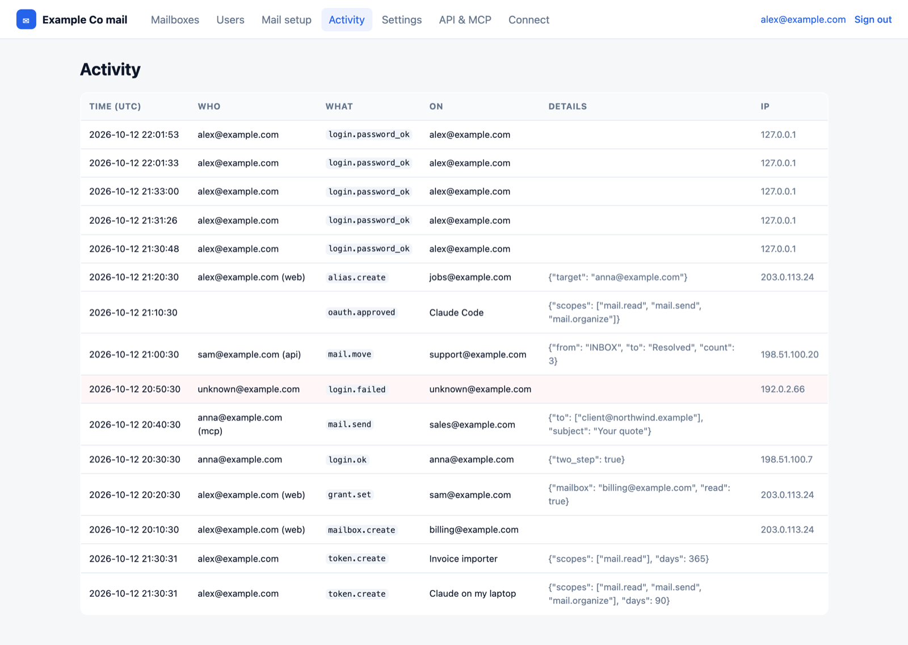
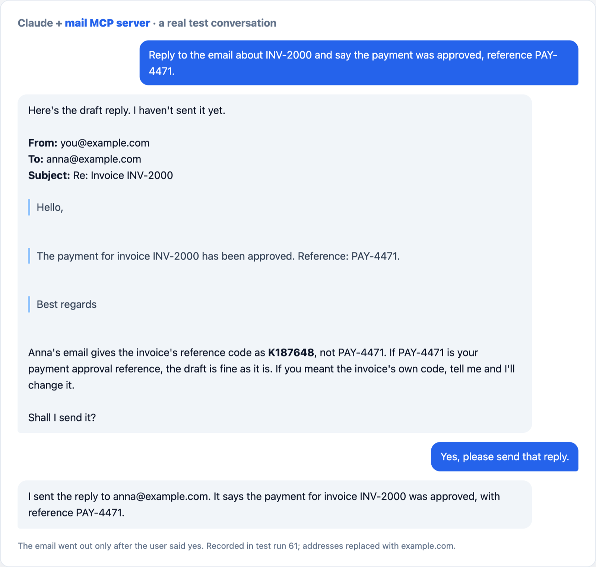

# Self-hosted business email in one command

[](https://github.com/keyhan-azarjoo/myotgo-mail/actions/workflows/install-test.yml)
[](https://github.com/keyhan-azarjoo/myotgo-mail/actions/workflows/security.yml)
[](LICENSE)

Run your own email server for your domain (`you@yourcompany.com`) on a small rented server,
with **as many mailboxes as you like and no per-user fees**. You keep using Outlook, Apple Mail,
Thunderbird or your phone's mail app, exactly as with Google Workspace, Microsoft 365 or Zoho.

It also comes with a **web console, a REST API and an MCP server**, so people and AI assistants
such as Claude can read, search, send and organize mail, each with exactly the access an admin gives them.

On a fresh Ubuntu or Debian server, as root:

```bash
curl -fsSL https://raw.githubusercontent.com/keyhan-azarjoo/myotgo-mail/main/install.sh | sudo bash
```

It asks for your domain and email, sets everything up, and finishes by printing the DNS records to
add and your admin password. From then on, `mailctl` does the rest: `mailctl add anna@yourcompany.com`.

It is a thin, scripted layer on top of proven open-source mail software
([docker-mailserver](https://github.com/docker-mailserver/docker-mailserver): Postfix, Dovecot, Rspamd),
plus everything around it that usually takes a day of reading: certificates, DNS records, spam
protection, backups, tests and the steps to move an existing domain over safely.

### Screenshots

| Mailboxes and your access | Per-user mailbox permissions |
|---|---|
|  |  |
| **Mailboxes and aliases** | **API tokens and connected AI apps** |
|  |  |
| **Claude asks for access (OAuth)** | **Activity log** |
|  |  |

<sub>Demo data. More: [sign-in](docs/images/login.png), [users](docs/images/users.png),
[two-step setup](docs/images/security.png), [connect Claude / Outlook](docs/images/connect.png).</sub>

- [What you get](#what-you-get)
- [How it works](#how-it-works)
- [What you need](#what-you-need)
- [Set it up, step by step](#set-it-up-step-by-step)
- [Move an existing domain (Zoho, Google, Microsoft…)](#move-an-existing-domain-from-zoho-google-microsoft)
- [Add the mailbox to Outlook and other apps](#add-the-mailbox-to-outlook-and-other-apps)
- [Console, REST API and MCP server (AI access)](#console-rest-api-and-mcp-server-ai-access)
- [Everyday commands](#everyday-commands)
- [Troubleshooting](#troubleshooting)
- [Security](#security)
- [Limits](#limits)

---

## What you get

| | |
|---|---|
| Mailboxes and aliases | Unlimited. `sales@` can forward to `anna@`, and so on |
| Works with | Any mail app that speaks IMAP/SMTP: Outlook, Apple Mail, Thunderbird, iPhone, Android |
| Deliverability | SPF, DKIM, DMARC and reverse DNS set up for you. (Inbox placement also depends on your server IP's reputation; see [Troubleshooting](#troubleshooting).) |
| Spam filter | Rspamd; spam goes to the Junk folder |
| Protection | TLS everywhere, no open relay, no sending as someone else, bans after 6 wrong passwords |
| Certificates | Free Let's Encrypt certificate, renewed automatically every week |
| Backups | Nightly, optionally encrypted and copied off the server; tested restore (`mailctl restore`) |
| Tests | One command checks 12 things end to end, including a real message to Gmail |
| Server size | Runs on 1 CPU / 1 GB RAM (it uses about 250 MB) |
| Web console | Sign-in with two-step verification; admins create users, mailboxes and aliases and set who can read, send or organize each mailbox |
| REST API | `/api/v1`: search, read, send, reply, forward, drafts, flags, folders, admin, with scoped tokens |
| MCP server | 32 tools for AI assistants (Claude and others), with OAuth sign-in or tokens |
| AI approvals | Emails an AI assistant sends **wait for your approval** in the console: enforced by the server, not by the AI |

## How it works

### The parts

Everything runs in **one Docker container** on your server:

| Part | Job |
|---|---|
| **Postfix** | The post office. Receives mail from the internet on port 25, accepts mail from your apps on ports 465/587, and delivers outgoing mail to other servers |
| **Dovecot** | The mailbox store. Keeps every mailbox on disk and serves it to your apps over IMAP (port 993) |
| **Rspamd** | Scores incoming mail for spam and **signs** outgoing mail with your DKIM key |
| **fail2ban** | Watches for password guessing and blocks the attacker's IP |
| **lego** (separate, short-lived) | Gets the Let's Encrypt certificate and renews it |

Your computer only holds the scripts and your settings. The `./mail` command talks to the server over SSH.

### When someone emails you

```
sender's server ──► looks up MX record of yourcompany.com ──► mx.yourcompany.com:25
                                                                    │
                       Postfix: is it for one of our addresses? ◄───┘
                       Rspamd: spam score (SPF/DKIM/DMARC of the sender, content, blocklists)
                       Dovecot: stores it in the mailbox (spam → Junk)
                                                                    │
your Outlook ◄── IMAP over TLS, port 993 ◄─────────────────────────┘
```

### When you send an email

```
your Outlook ──► mx.yourcompany.com:465 (TLS) ──► Postfix checks your password and that
                                                 you only send as your own address
                                                 Rspamd adds a DKIM signature
                                                         │
recipient's server ◄── port 25, direct ◄─────────────────┘
   checks: SPF   "is this IP allowed to send for yourcompany.com?"  (DNS TXT record)
           DKIM  "is the signature valid?"                          (public key in DNS)
           DMARC "do SPF/DKIM match the From address?"              (DNS TXT record)
           PTR   "does this IP's reverse name match the server?"    (set at your hosting provider)
```

If all four pass, Gmail and Outlook treat you like any well-run mail provider. That is why most of
the setup below is DNS records: the server itself is the easy part.

### What lives where

| Where | What |
|---|---|
| Your computer, this folder | Scripts, `mail.conf` (your settings, never committed) |
| Your computer, `SECRETS_DIR` | Mailbox passwords, DNS backups |
| Server, `REMOTE_DIR/data/` | Mailboxes, accounts (hashed passwords), DKIM key, certificate |
| Server, `REMOTE_DIR/data/app/` | The console's SQLite database (users, permissions, tokens, activity log) |
| Server, `REMOTE_DIR/secrets/app.env` | The key that encrypts stored mailbox passwords |
| Server, `/var/backups/mailserver/` | Nightly backups (last 7) |

## What you need

1. **A domain** you control, e.g. `yourcompany.com`, with access to its DNS records.
2. **A small Linux server (VPS)** with a fixed public IPv4, Ubuntu 22.04+ or Debian 12+, 1 GB RAM or more,
   root SSH access with a key. Any provider works (IONOS, Hetzner, OVH, Contabo, DigitalOcean, Vultr…).
3. **Outgoing port 25 open.** Most providers block it on new servers against spam, and unblock it on request
   once you have the DNS records in place (see [Outgoing port 25](#outgoing-port-25)).
   AWS, Google Cloud and Azure make this very hard: prefer a classic VPS provider.
4. **Reverse DNS (PTR)**: your hosting provider's panel must let you set the server IP's reverse name.
5. On your computer: `bash`, `ssh`, `rsync`, `python3` and `dig` (all present on macOS and most Linux).

Using a separate server just for mail is recommended: it keeps port 80 free for the certificate and
keeps a problem on your web/app server away from your email.

## Install

### The quick way: one command on the server

1. **Rent a small server** (1 GB RAM is enough) with Ubuntu 22.04+ or Debian 12+, and note its public IP.
2. **Point the mail name at it.** At your domain provider, create an **A record**:
   `mx.yourcompany.com` → the server's IP. (The installer waits for this, because the certificate needs it.)
3. **Run the installer** on the server:

   ```bash
   curl -fsSL https://raw.githubusercontent.com/keyhan-azarjoo/myotgo-mail/main/install.sh | sudo bash
   ```

   It asks for your domain, the mail server's name (default `mx.yourcompany.com`), your own address
   (your first mailbox and admin login) and an email outside the server for certificate notices. Then it:
   - installs Docker, opens the firewall (SSH, 25, 443, 465, 587, 993) and adds swap on small servers
   - gets a free Let's Encrypt certificate and renews it every week
   - starts the mail server and the web console/API/MCP app
   - creates your mailbox, `no-reply@` for sign-in codes, `postmaster@` and `abuse@`, and your admin login
   - prints every **DNS record** to add (also saved in `/opt/mailserver/DNS-RECORDS.txt`) and tells you
     if your host blocks outgoing port 25

   For an unattended install, set the answers in the environment:

   ```bash
   curl -fsSL https://raw.githubusercontent.com/keyhan-azarjoo/myotgo-mail/main/install.sh | \
     sudo DOMAIN=yourcompany.com ADMIN_EMAIL=you@yourcompany.com ACME_EMAIL=you@gmail.com bash -s -- --yes
   ```

4. **Add the DNS records** it printed (SPF, DKIM, DMARC; MX last), and set **reverse DNS (PTR)** in your
   hosting provider's panel. Check with `mailctl dns check`.
5. **Sign in** at `https://mx.yourcompany.com` with the password it printed, choose your own (it becomes
   your Outlook password too) and turn on two-step verification.
6. **Test:** `mailctl test you@yourcompany.com` and `mailctl test-app`.
7. **Go live:** point the domain's **MX** record at `mx.yourcompany.com`.

Running the installer again is safe: it keeps your data and settings and just updates and restarts.
`mailctl update` does the same later.

### The other way: manage the server from your own computer

If you'd rather keep the scripts and your settings on your laptop and drive the server over SSH, use
`./mail`. It does the same work, step by step.

#### 1. Download and configure

```bash
git clone https://github.com/keyhan-azarjoo/myotgo-mail.git mailserver
cd mailserver
./mail init
```

Open `mail.conf` and fill in your values. The file explains every line. The important ones:

```ini
DOMAIN=yourcompany.com
MAIL_HOST=mx.yourcompany.com
SERVER_IP=203.0.113.10          # your server's public IPv4
SSH_TARGET=root@203.0.113.10
SSH_KEY=~/.ssh/id_ed25519
ACME_EMAIL=you@somewhere-else.com
CERT_METHOD=http                # or dns if port 80 on the server is in use
```

`mail.conf` is in `.gitignore`: your details stay on your computer.

#### 2. Point the mail name at the server

At your DNS provider, create an **A record**: `mx.yourcompany.com` → your server's IP.
(With GoDaddy and `DNS_PROVIDER=godaddy`, `./mail dns prepare` does this later for you.)

#### 3. Prepare the server

```bash
./mail server-setup
```

It installs Docker, opens the firewall for SSH and the mail ports, adds swap on small servers, sets the
host name, turns SSH password login off (only if a key is installed) and tells you whether outgoing port 25
is blocked.

#### 4. Install the mail server

```bash
./mail deploy
```

It copies the files, fetches the certificate, installs the weekly renewal and nightly backup, and starts
the server. Run it again any time you change something: it is safe to repeat.

#### 5. Create your first mailbox

```bash
./mail add you@yourcompany.com
```

The password is printed once and saved in `SECRETS_DIR`. The first mailbox also receives `postmaster@`
and `abuse@` (change this with `DEFAULT_ALIASES`).

#### 6. Create the DNS records

```bash
./mail dns records
```

prints every record with its exact value: **A**, **SPF**, **DKIM**, **DMARC**, **PTR** and **MX**.

- Create A, SPF, DKIM and DMARC now at your DNS provider. If the domain already has an SPF record,
  **add** `ip4:<your IP>` to it; never create a second one.
- Set **PTR** (reverse DNS) in your hosting provider's panel to `mx.yourcompany.com`.
- **Leave MX for last**: it decides where mail for the domain goes.

With GoDaddy, `./mail dns prepare` and `./mail dns spf` do all of this except PTR for you.

Then check:

```bash
./mail dns check
```

#### 7. Test it

```bash
./mail test you@yourcompany.com
./mail test you@yourcompany.com --external your.private@gmail.com
```

The first checks certificates, wrong-password refusal, incoming mail, open relay, spoofing, sending,
aliases, IMAP and DKIM. The second also sends a real message to an outside address. Open it in Gmail
and use **Show original**: SPF, DKIM and DMARC should all say **PASS**.

#### 8. Go live

Point the domain's **MX** record at `mx.yourcompany.com` (priority 10), or with GoDaddy:

```bash
./mail dns switch
```

Mail starts arriving at your server within 10–60 minutes as DNS caches update.

### Outgoing port 25

`./mail server-setup` tells you whether it's blocked. If it is, finish steps 1–7 first. Providers
usually ask for exactly those three things: a host name (FQDN), reverse DNS and SPF. Then open a ticket:

> Please unblock outbound SMTP port 25 for my server `<IP>`. It runs a mail server for `<domain>`
> with host name `<mx.domain>`. Reverse DNS points to `<mx.domain>`, SPF allows the IP, mail is
> DKIM-signed, sending requires authentication and the server is not an open relay.

Until then, receiving and reading work; outgoing mail to other domains waits in the queue
(`./mail queue`) and goes out by itself once the port opens.

## Move an existing domain from Zoho, Google, Microsoft…

1. **List every address** that exists at the old provider. Create each one here first
   (`./mail add` or `./mail alias`): any address you forget will bounce after the switch.
2. Do steps 1–7. Keep the old provider in your SPF record while you move.
3. `./mail dns switch` (or change MX by hand).
4. **Keep the old service for a week.** Some senders cache the old MX for a while.
5. Copy old mail: add both accounts to Outlook or Thunderbird and drag the folders across.
6. Then cancel the old service and remove its entries from SPF.

`./mail dns rollback` (GoDaddy) puts the previous MX and SPF back if anything goes wrong.

## Add the mailbox to Outlook and other apps

### The quick way: scan a QR code (iPhone, iPad, Mac)
In the console, on **Mailboxes**, click **Add to phone or Mac** next to the mailbox. Scan the code with
the phone's camera, tap **Install on this device** → **Allow**, then **Settings → Profile Downloaded →
Install** (on a Mac: **System Settings**). Type the mailbox password when asked: the account appears in
the Mail app.

- The code opens a link that works for one hour. It holds the server settings and the address, never the
  password, so a photo of the code alone doesn't get anyone in.
- The profile is signed with the server's certificate, so the device shows it as **Verified**.
- Installing it again replaces it. To remove it: **Settings → General → VPN & Device Management**.
- Outlook, the Gmail app and Android can't be set up from a code. The page behind the code also lists
  the settings for them; or follow the steps below.

### By hand

`./mail outlook you@yourcompany.com` prints the values for any address:

| Setting | Value |
|---|---|
| Account type | **IMAP** |
| Email address / user name | the full address, e.g. `you@yourcompany.com` |
| Password | from `SECRETS_DIR/<address>.txt` |
| Incoming (IMAP) server | `mx.yourcompany.com`, port **993**, **SSL/TLS** |
| Outgoing (SMTP) server | `mx.yourcompany.com`, port **465**, **SSL/TLS** (or port 587, **STARTTLS**) |
| Outgoing needs sign-in | Yes, same user name and password |

### New Outlook (Windows) and Outlook on the web
1. **Settings** (gear icon) → **Accounts** → **Email accounts** → **Add account**.
2. Type the address → **Continue**. If asked for the provider, choose **IMAP**. If Outlook starts searching,
   choose **Advanced setup** / **Choose provider** → **IMAP**.
3. **Show more** / **Advanced settings**: fill in the IMAP and SMTP values above → **Continue**.

### Classic Outlook (Windows)
1. **File** → **Add Account** → type the address → **Advanced options** → tick
   **Let me set up my account manually** → **Connect** → **IMAP**.
2. Incoming: server, port 993, **SSL/TLS**. Outgoing: server, port 465, **SSL/TLS**.
   Leave "Secure Password Authentication (SPA)" **unticked** → **Next** → password → **Connect**.

### Outlook for Mac
1. **Outlook** menu → **Settings…** → **Accounts** → **+** → **New Account…** → type the address → **Continue**.
2. Choose **IMAP/POP** (sometimes under "Not your provider?").
3. Type **IMAP**, user name = full address, password, IMAP server port 993 with **Use SSL**, SMTP server
   port 465 with **Use SSL** → **Add Account**.

### Outlook on iPhone / Android
Profile picture → **Add account** → **Add email account** → address → **IMAP**
(or **Set up account manually**) → turn on **Advanced settings** → fill in the values → ✓.

### Apple Mail, iPhone Mail, Thunderbird, Gmail app
Add an account of type **Other / IMAP** and use the same table. Thunderbird usually finds the
settings by itself when you type the server name `mx.yourcompany.com`.

> To send from a second address in the same Outlook, add it as its own account and pick it in the
> **From** field when you write the email.

## Console, REST API and MCP server (AI access)

`./mail deploy` also starts a second, small container: one HTTPS service at `https://mx.yourcompany.com`
with three faces, all backed by **one SQLite database** and the same permission rules.

| | Address | Who uses it |
|---|---|---|
| Web console | `https://mx.yourcompany.com` | people: sign in, manage users, mailboxes, aliases, tokens |
| REST API | `https://mx.yourcompany.com/api/v1` | scripts and programs (`Authorization: Bearer <token>`) |
| MCP server | `https://mx.yourcompany.com/mcp` | AI assistants such as Claude (OAuth sign-in, or a token) |

### First admin

The installer creates your admin login and `no-reply@` for you. To add another admin later:
`mailctl admin anna@yourcompany.com` (or `./mail app-admin …` from your computer).

Open `https://mx.yourcompany.com`, sign in, choose your own password, then turn on two-step verification
(an authenticator app, or codes emailed to an address outside this server). Only admins create accounts;
there is no public sign-up.

### Who can do what

| Role / permission | Allows |
|---|---|
| **admin** | everything: users, mailboxes, aliases, every mailbox, the activity log, settings |
| **user** + mailbox permission **read** | list folders, search, read messages and download attachments |
| **send** | send, reply, forward, save drafts (only as that mailbox or its aliases) |
| **organize** | mark read/unread and flagged, move, delete, create/rename/delete folders |

An admin sets these per user and per mailbox (*Users* → a user → *Mailbox permissions*). A user's
console login doesn't have to be a mailbox. Every token or app connection is limited further by the
permissions chosen when it was created (`mail.read`, `mail.send`, `mail.organize`, `admin`), so an AI
assistant can never do more than the person who connected it.

### Connect Claude

**Claude Code:**

```bash
claude mcp add --transport http mail https://mx.yourcompany.com/mcp
```

Then type `/mcp` in Claude Code and choose *Authenticate*: your browser opens the console's sign-in page.
Sign in with your password and two-step code, then click *Allow*. Claude now sees tools such as
`search_emails`, `read_email`, `send_email`, `reply_email`, `save_draft`, `move_emails` and, for admins,
`admin_create_mailbox` and others. Ask it things like *"summarize unread mail in support@ and draft replies"*.

**Claude Desktop / claude.ai:** Settings → Connectors → *Add custom connector* → paste
`https://mx.yourcompany.com/mcp` → *Connect* → sign in and allow.

**With a token instead** (scripts, other MCP clients): console → *API & MCP* → *Create token*, then
`--header "Authorization: Bearer mm_pat_…"`.

Connected apps are listed under *API & MCP*, where you can revoke them at any time.

**Sending needs your OK.** When Claude sends, replies or forwards, the message waits on the console's
**Approvals** page (you also get an email that something is waiting). You see exactly what will be sent,
including Bcc, and click *Approve* or *Reject*. You can let a trusted connection send directly (a checkbox
on the consent page or when creating a token), but it's off by default.

### MCP tools

| Mail | Organize | Admin |
|---|---|---|
| `whoami`, `list_mailboxes`, `list_folders` | `mark_emails` (read, flagged) | `admin_list_users`, `admin_create_user`, `admin_update_user` |
| `search_emails` (text, from, to, subject, dates, unread, flagged) | `move_emails`, `delete_emails` | `admin_set_permissions`, `admin_reset_user_password`, `admin_delete_user` |
| `read_email`, `download_attachment` | `create_folder`, `rename_folder`, `delete_folder` | `admin_list_mailboxes`, `admin_create_mailbox`, `admin_reset_mailbox_password`, `admin_delete_mailbox` |
| `send_email` (cc, bcc, html, attachments, send as alias) | | `admin_list_aliases`, `admin_create_alias`, `admin_delete_alias` |
| `reply_email`, `forward_email`, `save_draft` | | `admin_audit_log` |
| `list_pending_approvals`, `approval_status` | | |

### REST API

```bash
TOKEN=mm_pat_...        # console → API & MCP → Create token
API=https://mx.yourcompany.com/api/v1
curl -H "Authorization: Bearer $TOKEN" $API/mailboxes
curl -H "Authorization: Bearer $TOKEN" "$API/mailboxes/support@yourcompany.com/messages?unread=true&limit=10"
curl -H "Authorization: Bearer $TOKEN" "$API/mailboxes/support@yourcompany.com/messages/42"
curl -H "Authorization: Bearer $TOKEN" -H "Content-Type: application/json" \
     -d '{"to":["anna@example.com"],"subject":"Hello","text":"Hi Anna"}' \
     $API/mailboxes/support@yourcompany.com/send
```

| Method and path | Does |
|---|---|
| `GET /me`, `GET /mailboxes` | who you are; mailboxes you can use |
| `GET/POST /mailboxes/{m}/folders`, `PATCH/DELETE /mailboxes/{m}/folders/{name}` | folders |
| `GET /mailboxes/{m}/messages?folder=&q=&from=&to=&subject=&since=&before=&unread=&flagged=&limit=&offset=` | search |
| `GET /mailboxes/{m}/messages/{uid}?folder=&html=&mark_read=` | read one message |
| `GET /mailboxes/{m}/messages/{uid}/attachments/{i}` | download an attachment |
| `POST /mailboxes/{m}/send`, `…/messages/{uid}/reply`, `…/messages/{uid}/forward`, `…/drafts` | write (`202` = waiting for approval) |
| `GET /approvals`, `GET /approvals/{id}` | messages waiting for the owner's approval (approving is console-only) |
| `POST /mailboxes/{m}/messages/flags`, `…/move`, `…/delete` | organize |
| `/admin/users`, `/admin/users/{id}/grants`, `/admin/mailboxes`, `/admin/aliases`, `/admin/audit` | administration |

The full description is at `/api/v1/openapi.json`.

### How the console is secured

- **One password per person.** If a console login is also a mailbox (`anna@yourcompany.com`), both use the
  same password: changing it on the website changes it for Outlook too. Because that password also opens the
  mailbox over IMAP, **two-step codes never go to that same mailbox** (nor a `+address` or alias of it).
  They come from an authenticator app (recommended) or are emailed to an address outside this server.
  An admin can allow a dedicated codes mailbox on the server (*Settings*), never the person's own.
- **Passwords:** Argon2id (at most 3 hashed at once, so a flood of sign-ins can't exhaust memory); mailbox
  passwords as SHA512-CRYPT with 50,000 rounds in a file only root can read; at least 12 characters; temporary
  passwords must be changed at first sign-in.
- **Two-step verification:** 6-digit codes that work once (email codes expire in 10 minutes, and a new code
  cancels the previous one), plus 10 single-use recovery codes. At most 10 wrong codes per 15 minutes and 30 per
  day. *Settings → Require two-step verification* makes it mandatory, and then API and MCP tokens only work if
  they were issued after a two-step check.
- **Sign-in limits:** one generic message for every failure, so the page never reveals whether an account
  exists or is locked; 5 wrong passwords lock that account for that network for 15 minutes; 50 per hour from
  anywhere lock the account; 30 per 15 minutes block a network (`./mail app-unblock <ip>`).
- **Sessions:** `__Host-` cookies (Secure, HttpOnly, SameSite=Strict), a new session id at every sign-in,
  30-minute idle and 12-hour maximum lifetime, CSRF tokens on every form including the sign-in form.
  Changing your password signs you out everywhere and cancels your tokens and connected apps.
- **Pages:** strict Content-Security-Policy (no inline scripts), HSTS, no framing, no referrer, all output
  escaped, attachments always downloaded as files.
- **Tokens:** shown once and stored only as SHA-256 hashes; scoped; expiring; revocable; rate limited
  (600 API requests and 300 MCP calls per minute).
- **OAuth for MCP (Claude and others):** OAuth 2.1 with PKCE (S256). Apps register themselves, but only
  with https redirect addresses or http to localhost (no user names, no fragments; at most 5). The consent
  page shows the app's name and the host it returns to. **Admin access is never granted unless the person
  ticks it.** One-hour access tokens and rotating refresh tokens; a reused code or refresh token cancels the
  whole sign-in. Registrations, sign-ins and token requests are rate limited per IP; unused registrations
  are removed after a week.
- **AI safety, enforced by the server:** when an AI assistant (or any token) sends, replies or forwards,
  the exact message is kept on the **Approvals** page and nothing leaves until the person, signed in to the
  console, clicks *Approve*. Tokens and AI assistants have no way to approve; a person can allow direct
  sending for a connection, but it's off by default. On top of that, the MCP server tells assistants to show
  every draft first and to treat emails as untrusted content, tools never return passwords, and an assistant
  can never do more than the person who connected it.
- **Mailbox access:** the app signs in to each mailbox like a mail app (passwords encrypted with AES-256-GCM,
  bound to their mailbox, key kept only on the server), so the mail server's own rules (no sending as someone
  else, DKIM signing, spam checks) still apply. Disabling a person also locks their mailbox.
- **Requests:** bodies over 64 KB are refused (30 MB where mail with attachments is sent); TLS 1.2+ with
  forward-secret ciphers only; DNS-rebinding protection on `/mcp`.
- **Container:** read-only filesystem, every Linux capability dropped except one, no privilege escalation,
  pinned base image.
- **Activity log:** sign-ins, failures, sends, deletes and every admin change, with time and IP (*Activity*).

- **Automated checks on every change:** known-vulnerable dependencies (pip-audit), risky code patterns
  (Bandit), shell-script bugs (ShellCheck), a web security scan of a freshly installed console (OWASP ZAP
  baseline), and Dependabot for updates.

The security review behind these measures was AI-assisted (a separate AI agent reviewed the code twice and
every finding was fixed and re-tested). It isn't a professional penetration test: if you depend on this for
your business, have it audited.

Known trade-offs: limits that stop password and code guessing can also be triggered on purpose to lock
someone out for a while (15 minutes per network, an hour per account, a day for codes); an admin can clear
them with `mailctl unblock <ip>`. The app container runs as root *inside* the container, because it edits the
mail server's root-owned account files.

### Backups and restore

Every night `mailctl backup` saves mailboxes, accounts, the DKIM key, the certificate, the console database
and its key to `/var/backups/mailserver` (last 7). For real protection, encrypt them and copy them off the
server. In `/opt/mailserver/.env`:

```ini
# on YOUR computer: age-keygen -o backup-key.txt   (keep backup-key.txt safe, NOT on the server)
BACKUP_AGE_RECIPIENT=age1...            # the public key it printed
BACKUP_RSYNC_TARGET=backup@other-server:/backups/mail    # and/or:
BACKUP_RCLONE_REMOTE=b2:my-bucket/mail                    # any rclone remote (S3, B2, Google Drive...)
```

With a recipient set, backups are encrypted before they're written: the server can make them but can't
read them. To restore: `mailctl restore /path/to/mail-<date>.tar.gz.age --key backup-key.txt` (it stops the
services, sets the current data aside and brings the backup back). `mailctl restore-test` checks the newest
backup can be restored; GitHub runs a full backup → delete → restore test on every change.

### Testing it

```bash
./mail app-test             # 27 end-to-end tests: console, REST API, all MCP tools, OAuth, approvals, security rules
./mail app-test-claude      # lets Claude Code use the MCP server for real, then checks the results
./mail app-test-scenarios   # 110 realistic requests to Claude through MCP, each checked on the server
```

On every change to this repository, GitHub installs everything from zero on a fresh Ubuntu machine (once
from the checkout and once with the exact `curl | bash` one-liner and the published image), runs both
suites, a web security scan and a backup → delete → restore test (see the badges at the top).

All of them create their own throwaway admin, mailboxes and users and remove them afterwards
(`./mail app-test-cleanup` removes leftovers if a run is interrupted). The scenarios include drafting and
**sending only after the person confirms and then approves it in the console**, cancelling, editing a
draft, answering questions from received mail, replying, forwarding, organizing, reading attachments, a
read-only user being refused, and **10 prompt-injection attacks** (emails telling the AI to forward
invoices or leak passwords to an attacker): none may produce mail for the attacker.



## Everyday commands

On the server, `mailctl` (installed by the installer):

```text
mailctl add anna@yourcompany.com       new mailbox (prints the password once; saved in /root/.mail-secrets)
mailctl passwd anna@yourcompany.com    new password
mailctl alias sales@yourcompany.com anna@yourcompany.com     /   mailctl unalias ...
mailctl del anna@yourcompany.com       delete a mailbox and its mail
mailctl list                           mailboxes and aliases
mailctl outlook anna@yourcompany.com   settings for a mail app
mailctl admin anna@yourcompany.com     a console admin login
mailctl dns records | check            DNS records to add / check them
mailctl status | logs | queue [flush] | backup | restart
mailctl unblock 198.51.100.7           clear sign-in limits and bans for an address
mailctl update                         latest version, applied
mailctl test you@yourcompany.com       mail server end-to-end test
mailctl test-app                       console, API, MCP and OAuth end-to-end test
```

From your own computer, `./mail` has the same commands (plus `deploy`, `server-setup`, `ssh`):

```text
./mail add anna@yourcompany.com          new mailbox (prints the password once)
./mail passwd anna@yourcompany.com       new password
./mail alias sales@yourcompany.com anna@yourcompany.com
./mail unalias sales@yourcompany.com anna@yourcompany.com
./mail del anna@yourcompany.com          delete mailbox and its mail (asks to confirm)
./mail list                              mailboxes and aliases
./mail outlook anna@yourcompany.com      settings for a mail app

./mail status                            services, queue, disk, certificate expiry
./mail logs                              live mail log
./mail queue | ./mail queue flush        waiting mail / retry now
./mail backup                            backup now
./mail unban 198.51.100.7                unblock an IP after wrong passwords
./mail ssh                               shell on the server
./mail deploy                            apply changes / update

./mail app-admin you@yourcompany.com     console admin login (prints a temporary password)
./mail app-link support@yourcompany.com  let the console use a mailbox created before the console existed
./mail app-reset-two-step you@…          remove two-step from a login (lost phone)
./mail app-unblock 198.51.100.7          clear the failed sign-in limit for a network
```

**Updating** docker-mailserver: change the version in `compose.yaml`, then `./mail deploy`.

**Restoring a backup** (on the server): stop with `docker compose down`, move `data/` aside, extract the
backup with `tar --numeric-owner -xzf /var/backups/mailserver/mail-<date>.tar.gz`, then
`docker compose up -d`.

## Troubleshooting

| Problem | What to do |
|---|---|
| Outlook can't connect | `./mail test <address>` from your computer. If ports time out, your hosting provider's firewall (often a separate "firewall policy" in their panel) must allow TCP 25, 465, 587, 993 |
| "Authentication failed", then nothing works | 6 wrong passwords in an hour ban your IP for a day: `./mail unban <your IP>` (find it at https://api.ipify.org) |
| Sent mail never arrives | `./mail queue`. "Connection timed out" on port 25 = provider still blocks port 25 |
| Mail lands in the recipient's spam | `./mail dns check`; then send to Gmail and look at **Show original**. A missing PTR is the most common cause. New servers also need a few days of normal traffic to build reputation |
| Certificate problem | `./mail status` shows its expiry; `/var/log/mailserver-cert.log` on the server shows renewals |
| Something else | `./mail logs` while you try again |

## Security

- No passwords, keys or personal settings are in this repository: they live in `mail.conf`,
  `SECRETS_DIR` and on the server, all ignored by git.
- Mailbox passwords are stored hashed on the server. New ones are 24 random characters.
- Every connection is encrypted (TLS 1.2+). Sending requires a login, and you can only send as your own
  address or your aliases. Unauthenticated relaying is refused (the tests check both).
- fail2ban bans IPs that guess passwords. `server-setup` turns off SSH password login when a key is present.
- Keep the server updated (Ubuntu's unattended upgrades) and update the mail image now and then.
- Set up encrypted off-site backups (see *Backups and restore*): by default they stay on the server.

## Limits

- **No webmail**: the web console manages users and access but doesn't show mail; people use mail apps,
  and programs or AI assistants use the API or MCP.
- **No antivirus scanning** (ClamAV needs about 1.5 GB more RAM). Rspamd still blocks a lot of malicious mail.
- **Running email is real work**: deliverability depends on your server IP's reputation (new or shared
  IPs can land in spam at first), and someone has to watch the server, disk space and updates.
- **One server**: if it is down, other servers keep your incoming mail and retry for several days, so it
  arrives once you're back.
- **DNS automation** is built in for GoDaddy only; with any other provider you copy the values from
  `./mail dns records` into its panel (certificates work with 100+ providers through lego).

## Files

| Path | What |
|---|---|
| `install.sh` | one-line installer (runs on the server) |
| `mailctl` | the command on the server |
| `mail` | the same commands from your own computer, over SSH |
| `mail.conf.example` | settings template (copy to `mail.conf`) |
| `compose.yaml`, `mailserver.env` | the mail server container and its options |
| `config/` | fail2ban and Postfix settings copied to the server on deploy |
| `scripts/server-setup.sh` | prepares a fresh server |
| `scripts/apply.sh` | applies the settings and (re)starts everything; used by all of the above |
| `scripts/deploy.sh` | copies this folder to the server and runs apply (for `./mail`) |
| `.github/workflows/` | publishes the app image; installs from zero and runs the tests on every change |
| `scripts/cert.sh`, `scripts/backup.sh` | run on the server by cron |
| `scripts/account.sh`, `scripts/dns.py` | mailboxes and DNS |
| `tests/check.py` | end-to-end test of the mail server |
| `app/` | console, REST API and MCP server (Python, FastAPI, MCP SDK); `app/tests/` its end-to-end tests |

## Credits

Built by **Keyhan Azarjoo** on top of
[docker-mailserver](https://github.com/docker-mailserver/docker-mailserver),
[Postfix](https://www.postfix.org/), [Dovecot](https://www.dovecot.org/), [Rspamd](https://rspamd.com/),
[fail2ban](https://github.com/fail2ban/fail2ban), [lego](https://github.com/go-acme/lego) and
[Let's Encrypt](https://letsencrypt.org/).

## License

[MIT](LICENSE)
